<p align="center">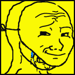</p>

<p align="center">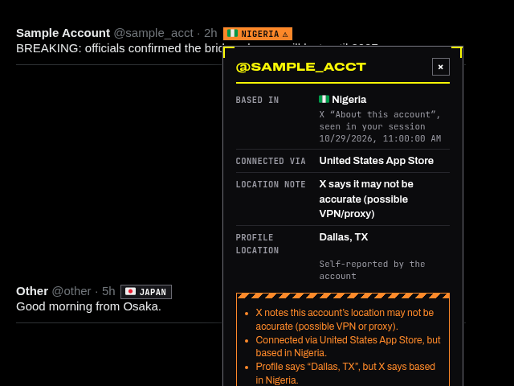</p>

# KNOW WHERE YOUR INFORMATION IS COMING FROM
# CONFIRM THE SOURCE
# SOME ACCOUNTS AREN'T WHERE THEY SAY THEY ARE

[](LICENSE)

**CHUD FINDER** is a provenance layer for X. It's a Manifest V3 extension for Chrome and Brave.

Every author gets a badge showing the country **X itself** reports the account is based in. Click the badge to see the evidence. Then decide for yourself.

> **LOCATION IS A SIGNAL, NOT PROOF.**
> Where an account operates is context. It never tells you whether a post is true or false. An account's country never makes it a bad actor. Findings stay at country level, and Chud Finder never infers nationality.

<p>
  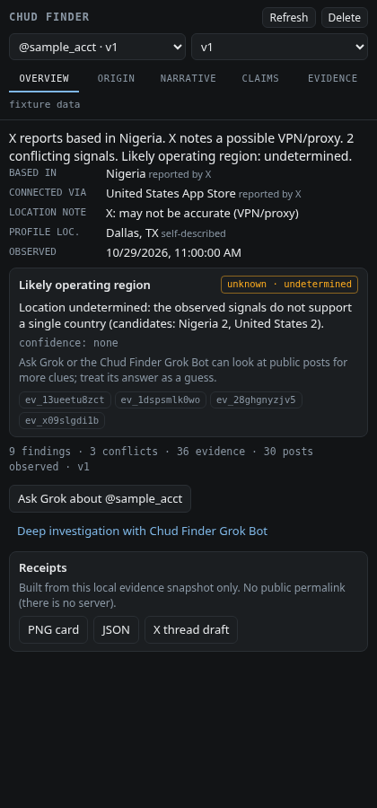
  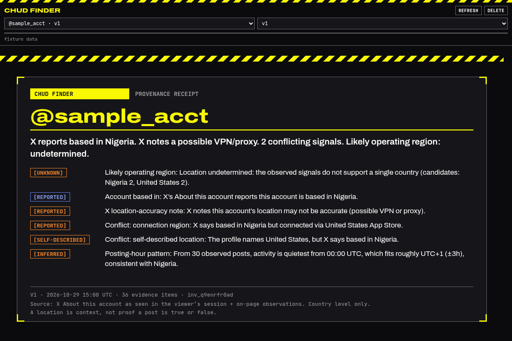
</p>

<sub>Screenshots are headless renders of the real UI code using a made-up <code>@sample_acct</code> fixture. They are not captures of live X.</sub>

---

## SEE IT IN ACTION

> **DEMO DATA.** Every account below is fictional (`@demo_*` / `@sample_*`), with letter avatars. The timeline is a seeded mock of X's markup (`demo/`), running the **real built content script** in headless Chrome with a mocked *About this account* response. These are not captures of live X. Reproduce: `npm run build && PUPPETEER_CORE=<path> node demo/shoot.mjs`.

| | |
|---|---|
| 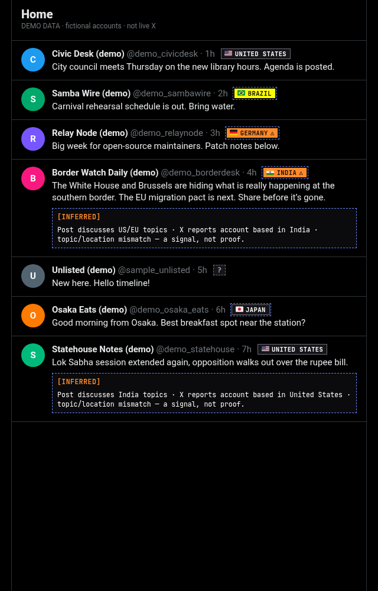 | 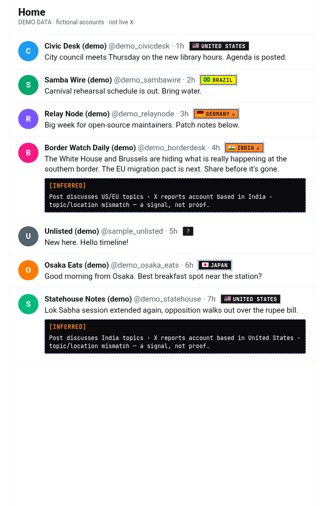 |
| **Timeline (dark).** The home-country badge is plain, the highlighted country is yellow, the VPN/mismatch note is orange ⚠, unknown shows `?`, and accounts outside your home country get a dashed outline. | **Timeline (light).** The same badges carry their own colors, so they read the same on both X themes. |
| 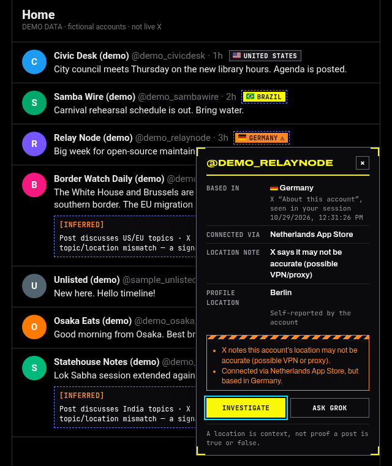 | 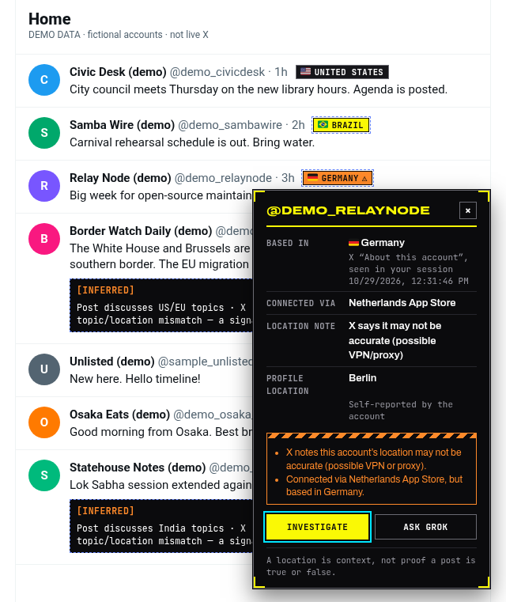 |
| **Full spread (dark).** Based in, Connected via and the location note, each with its source and when it was seen, plus the self-reported location and warnings. | **Full spread (light).** |
| 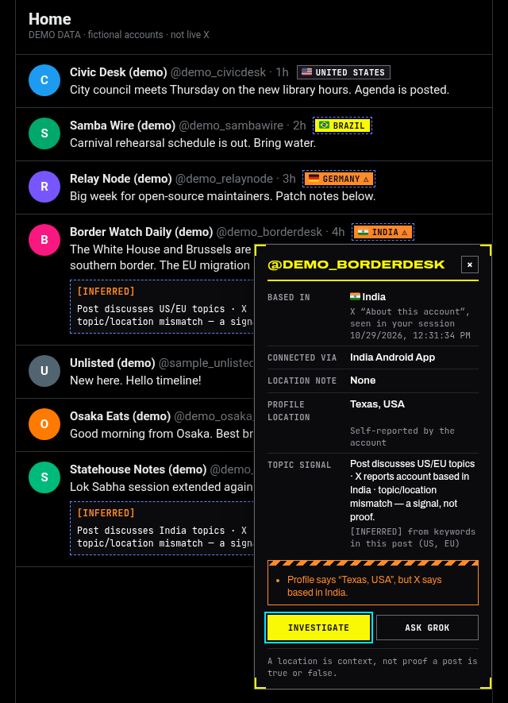 | 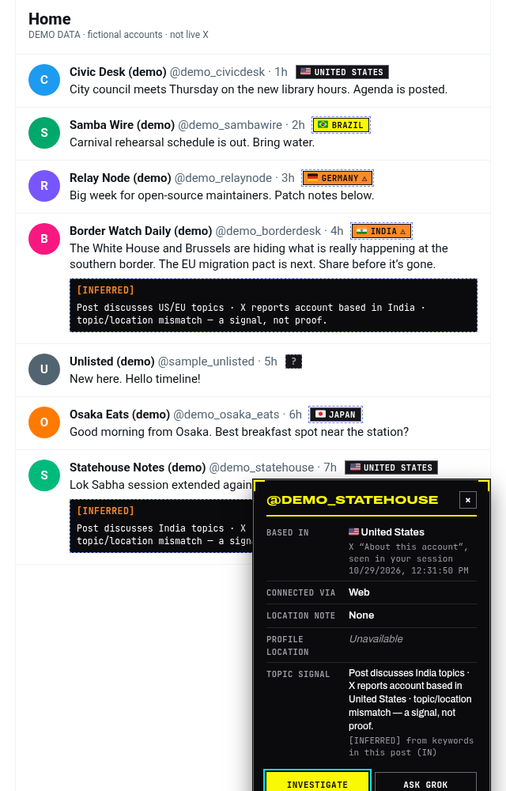 |
| **Topic/location mismatch.** The post discusses US/EU topics and X reports the account based in India. The note is labeled `[INFERRED]`: it's a signal, not proof. | **The same rule works both ways.** A US-based account posting about India's domestic politics gets the same neutral note. |
| 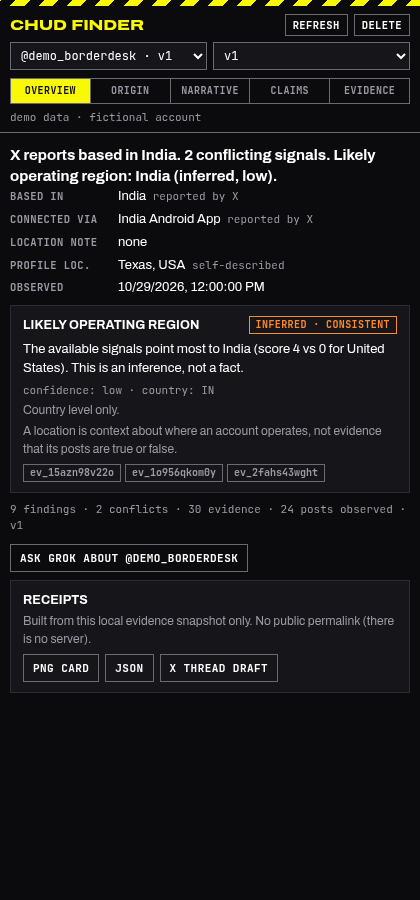 | 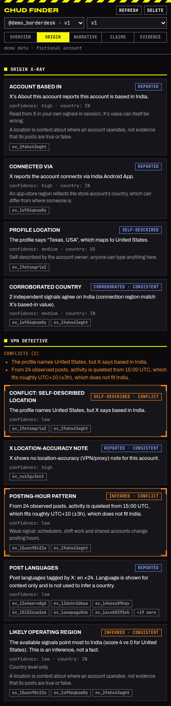 |
| **Side panel, Overview.** | **Side panel, Origin.** |

**TOPIC MODE** tags each post using a small, auditable keyword list (`src/shared/topics.ts`: US, EU, UK, India, Canada, Australia, Brazil) and compares the tags with the country X reports. When they don't match, it shows one fixed sentence: *"Post discusses US/EU topics · X reports account based in India · topic/location mismatch — a signal, not proof."* Plenty of people follow other countries' news. The note never says anything about intent, accuracy or nationality.

## WHAT IT DOES

**ORIGIN X-RAY.** Shows *Based in*, *Connected via* and X's location note, each with its source and when it was seen in your session, next to the profile's self-reported location. Anything missing reads **Unavailable**.

**VPN DETECTIVE.** Compares the signals: X's location-accuracy note, *Connected via* vs *Based in*, the self-described location vs *Based in*, and the posting-hour pattern (a UTC-offset band of ±3h). It runs deterministically, inside your browser. If the signals don't agree, it says **LOCATION UNDETERMINED** instead of guessing.

**NARRATIVE + CLAIMS.** Lists only what's observable on the page: post text, links, quotes, replies and timestamps. Each post has an **ASK GROK** button that opens grok.com with a neutral, prompt-injection-hardened question and copies it to your clipboard. The extension does no scoring of its own. Grok's answers are hypotheses to check.

**RECEIPTS.** Export a PNG card, a JSON file (cited evidence only), or a copyable X thread draft. Nothing is ever posted for you.

**LOCAL WORKSPACE.** The side panel has five tabs: Overview, Origin, Narrative, Claims and Evidence. Investigations are versioned (each Refresh creates a new version) and keep append-only evidence history.

## EVERY FINDING SHOWS ITS BASIS

| LABEL | MEANING |
|---|---|
| `REPORTED` | X's own *About this account* data says it. |
| `SELF-DESCRIBED` | The account says it about itself, for example its profile location. |
| `CORROBORATED` | Independent signals agree. |
| `INFERRED` | Derived from patterns such as posting hours. Always comes with a confidence level, never stated as fact. |
| `UNKNOWN` | The evidence doesn't support an answer. |

Findings cite evidence items by id. A finding that cites nothing, cites evidence that doesn't exist, or names a country the evidence doesn't support is rejected before it's shown.

## INSTALL (BRAVE / CHROME)

1. Download `chud-finder-<version>.zip` from [**Releases**](../../releases) and extract it to a folder. `manifest.json` sits at the top level of the zip.
2. Open `brave://extensions` or `chrome://extensions`.
3. Turn on **Developer mode**, click **Load unpacked**, and choose the extracted folder.
4. Open x.com while logged in. Badges appear next to authors. Click a badge, then **INVESTIGATE**, to open the side panel. Before investigating, scroll the account's profile first so it has enough posts for the posting-hour signal (it needs at least 12).

To update, extract over the same folder, click reload on Chud Finder, and refresh X. Requires Chromium 116 or later.

## SETTINGS

Right-click the toolbar icon and choose **Options**. You can set warnings, the popover, Ask Grok, topic mode with your home country, and countries to highlight. Highlights are empty by default.

**GIST SYNC.** You can point Chud Finder at a raw GitHub Gist URL (https only). It checks the gist on startup and every 10 minutes. The gist is read as data only, never as code, and is strictly validated. Schema: [SETTINGS_SCHEMA.md](SETTINGS_SCHEMA.md) (`schemaVersion 1`). You can also paste or export a settings code.

## PRIVACY

- **No server.** **No AI API.** **No accounts.**
- Lookups use **your own logged-in X session**, as same-origin requests to x.com.
- Investigations are stored in `chrome.storage.local` on your machine.
- Data goes only between your browser and x.com. It reaches grok.com only when you click Ask Grok, or a gist URL only if you set one.

## BUILD FROM SOURCE

```
npm install
npm run build      # -> dist/ (unpacked extension) + chud-finder-<version>.zip  (Node >= 22.18)
npm test           # build + all suites (TS node:test, legacy suites, python bot tests)
npm run typecheck
```

## Layout

```
src/shared/   typed contracts + zod schemas (Account, Evidence, Finding, Claim, Post, RelationshipEdge,
              Investigation, Snapshot, InvestigationEvent, Export), deterministic engine, sanitizer,
              Ask Grok prompts, receipts, country + tz tables, settings schema (schemaVersion 1)
src/ext/      content script, X DOM adapter (versioned), popover, background, side panel, store, options, popup
static/       manifest.json, HTML/CSS, flag font, icons
test/         *.test.ts (node --test), legacy/*.cjs (1.2.0 suites run against dist/)
tools/        build.mjs (esbuild + zip), gen-tz.py, validate-settings.cjs, shots/ (fixture screenshots)
bot/          Grok Bot lookup helpers (python)
verification/ test results, fixture screenshots
```

## How it works

- `page.js` runs in the page's own JS world and only observes X's own GraphQL traffic. It picks up the web client's bearer token and the `AboutAccountQuery` id, the self-reported `location` of users, and the recent posts in timeline responses (id, text, time, language tag, links). It only posts messages to the content script.
- The content script reads `About this account` (`GET /i/api/graphql/<id>/AboutAccountQuery`) as a same-origin request with your session. It caches results (24 h, or 6 h when there's no data), dedupes lookups, spaces them out, and backs off on 429.
- **Investigate** builds an `AccountObservation` from what this tab has seen: the About data with `observedAt`, the self-described location, and on-page plus timeline posts. It's validated with zod and sent to the service worker, which runs the engine and stores the new version.
- **The engine** (`src/shared/engine.ts`) makes evidence with stable ids: same source, kind, subject and value gives the same id, and a re-observation just updates `lastSeenAt`. Findings come from that evidence, and every one passes citation validation. A finding citing evidence that doesn't exist, a reported/inferred finding with no citation, a country not supported by the cited evidence, or text crossing the hard boundaries is rejected and logged as a `validation_failed` event.
- **VPN Detective signals:** X's location-accuracy note, *Connected via* vs *Based in*, the self-described location vs *Based in*, and the posting-hour pattern. The quietest 6-hour window gives a UTC-offset band of ±3h, checked against tzdata offsets per country. The likely operating region is *reported* when nothing conflicts. Otherwise it's a low/medium-confidence *inferred* country when the signals clearly agree, or **Location undetermined**.
- **Untrusted text** (posts, profile fields) is cleaned (control, zero-width and bidi characters stripped) and rendered with `textContent` only. Links must be `https:`. In Ask Grok prompts the text is quoted inside `<< >>` as data, with fixed instructions last, so a post can't rewrite the request.

## LIMITS

- **Not yet verified on live X.** The tests run against jsdom fixtures and recorded-shape responses. See [verification/](verification/README.md).
- **X's DOM and endpoints may change.** Selectors are kept in one file, `src/ext/xdom.ts`. A change on X's side may need an update.
- **X's data isn't ground truth.** *Based in* is X's estimate, and the VPN note only means X thinks the location *may* be inaccurate.
- **You need to be logged in to X.** Logged out, badges show `?`.
- **Rate limits.** X limits the lookup endpoint, so heavy scrolling pauses lookups for a while.

## Design system and fonts (2.1.0)

Tokens live in `src/ext/styles/tokens.ts`. The build inlines them into every CSS/HTML file and the receipt canvas uses them directly. All custom properties use the `--cf-` prefix and are set only on Chud Finder's own `.cf-*` elements, so nothing leaks into X. The look: void-black ground, system-yellow field/mark, overstructure-blue for reported tags, ember-orange for caution/conflict, emissive-cyan for focus, 0 radius, hairline rules, 2.4px section rules, registration corners and hazard stripes, and mono uppercase labels.

Bundled fonts (no remote loading, served via `web_accessible_resources`):

| Font | File | License |
|---|---|---|
| Archivo (variable, wdth 62–125, wght 100–900, Latin subset) | `static/fonts/Archivo-Variable-latin.woff2` | SIL OFL 1.1, `static/fonts/OFL-Archivo.txt` |
| JetBrains Mono (variable, wght 400–800, Latin subset) | `static/fonts/JetBrainsMono-Variable-latin.woff2` | SIL OFL 1.1, `static/fonts/OFL-JetBrainsMono.txt` |
| Twemoji Country Flags | `static/fonts/TwemojiCountryFlags.woff2` | see `static/fonts/LICENSE-TwemojiCountryFlags.md` |

## LICENSE

Code: [MIT](LICENSE) © 2026 Nick Pittsinger. Bundled fonts keep their own licenses (SIL OFL 1.1 for Archivo and JetBrains Mono; see `static/fonts/`).
